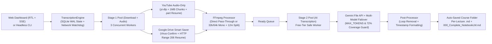

<div align="center">

# 🎙️ Gemini Verbatim Transcripts
### مُفرِّغ المحاضرات الذكي — Lightweight, Outage-Resilient Lecture Audio & Verbatim Transcriber

[](https://www.python.org/downloads/)
[](LICENSE)
[](https://github.com/Biexy/Gemini-Verbatim-Transcripts/actions/workflows/ci.yml)
[](lecture_transcriber/web/server.py)
[](#supported-sources)
[](#notebooklm-ready-output)

**Fast, ultra-lightweight, bandwidth-saving lecture transcriber engineered for slow or unstable internet connections.**  
Downloads audio-only streams from **YouTube** & **Google Drive**, survives disconnects/crashes with byte-level resume, transcribes verbatim with `[MM:SS]` timestamps via **Google Gemini AI** (optimized for Free Tier), and exports clean **Markdown** + a single combined **NotebookLM Master file**.

*أداة خفيفة وفائقة الاعتمادية لتحميل صوت المحاضرات من **YouTube** و **Google Drive** وتفريغها حرفياً مع الطوابع الزمنية `[MM:SS]` باستخدام **Google Gemini**، مصممة خصيصاً للإنترنت البطيء والمتقطع وتوليد ملفات جاهزة مباشرة لـ **NotebookLM**.*

</div>

---

## ✨ Key Engineering Highlights

| Capability | How It Works | Real-World Benefit |
|---|---|---|
| **⚡ Ultra-Low Bandwidth (`eco` Mode)** | Prefers compact speech-clear audio-only streams (`<=64kbps` M4A/Opus) across multiple YouTube clients (`default → android/ios → tv/web`) & Google Drive smart transcoded streams before any video fallback. | **~84% bandwidth savings** (e.g., **10.0 MB** M4A audio instead of **63.8 MB** 360p MP4 per 30-min lecture) + direct upload skip when already compact. |
| **🔌 Outage & Crash Resilience** | SQLite **WAL** persistent state machine (`state.db`), HTTP `Range: bytes=<offset>-` resumption for Google Drive, `.part` resume for YouTube, and a background network watchdog. | Survives Wi-Fi drops, ISP resets, or PC shutdowns — automatically pauses while offline and resumes from the exact byte upon reconnect. |
| **🧠 Free-Tier Multi-Model Failover** | Ordered quality-first Gemini chain (`gemini-3.6-flash → gemini-3-flash-preview → gemini-3.5-flash → gemini-3.8-flash → gemini-3.5-flash-lite → gemini-3.1-flash-lite`) with fast `503/504` failover & per-model `429` RPD skipping. | Maximizes free daily high-accuracy requests while keeping downloaded audio cached if quota runs out. |
| **🛡️ Truncation & Loop Guards** | Splits long lectures into **12-minute** FFmpeg chunks with automatic `[MM:SS]` offset stitching, validates `finish_reason != MAX_TOKENS` & **≥72% timestamp coverage**, and strips AI repetition loops. | Eliminates silent mid-lecture cutoffs, missing minutes, and infinite hallucination loops. |
| **🌍 Bilingual Technical Verbatim** | Dedicated prompt preserves **English technical terms & acronyms** (`Embedded System`, `I2C`, `ADC`, `RS-232`, `CPU`) in English script inside Arabic explanations, plus accurate Quranic/academic terminology. | Clean, searchable study notes for CS, engineering, medical, and Islamic/Arabic courses. |
| **🪶 Zero-Bloat Local Web UI + CLI** | Built on Python stdlib `ThreadingHTTPServer` + live **Server-Sent Events (SSE)** — zero Flask, FastAPI, Electron, or external CDN dependencies. | Boots in **<0.2s**, tiny RAM footprint, full Arabic RTL dark dashboard that works even while offline. |

---

## 🏗️ Architecture



---

## 🚀 Quick Start

### ⚡ One-Command Install *(Recommended — Auto-installs Python, FFmpeg, isolated `.venv`, & Desktop Shortcut)*

**Windows (PowerShell):**
```powershell
irm https://raw.githubusercontent.com/Biexy/Gemini-Verbatim-Transcripts/main/install.ps1 | iex
```

**macOS / Linux:**
```bash
curl -fsSL https://raw.githubusercontent.com/Biexy/Gemini-Verbatim-Transcripts/main/install.sh | bash
```

> Works even without Git installed. Re-running the same command updates the app in-place while preserving your config & database.  
> After installing, launch anytime via `gemini-transcribe` in any terminal or the **Desktop shortcut**!

---

### 🛠️ Manual Installation

#### 1. Prerequisites
- **Python 3.10+**
- **FFmpeg & FFprobe** installed and available in `PATH`:
  - Windows: `winget install Gyan.FFmpeg` (or `choco install ffmpeg`)
  - macOS: `brew install ffmpeg`
  - Ubuntu/Debian: `sudo apt install ffmpeg`
- **Google Gemini API Key** — free key from [Google AI Studio](https://aistudio.google.com/apikey)

#### 2. Install Minimal Dependencies
Only 3 lightweight packages (`yt-dlp`, `google-genai`, `requests`):

```bash
git clone https://github.com/Biexy/Gemini-Verbatim-Transcripts.git
cd Gemini-Verbatim-Transcripts
pip install -r requirements.txt
```

#### 3. Launch the Local Web Dashboard
- **Windows (1-Click)**: Double-click **`Launch_Transcriber.bat`**
- **Any OS (Terminal)**:
  ```bash
  python run.py
  ```
  Opens automatically at `http://127.0.0.1:8765`. Click **الإعدادات (Settings)** to paste your Gemini API key (or set the `GEMINI_API_KEY` environment variable) and pick your output directory.

#### 4. Headless CLI Mode
```bash
# Transcribe YouTube videos/playlists and Google Drive files/folders directly
python run.py --cli --course "Embedded_Systems" --mode eco \
  --urls "https://youtu.be/VIDEO_ID" "https://drive.google.com/file/d/FILE_ID/view"

# Read URLs from a text file (one URL per line) and also save lightweight MP3 copies
python run.py --cli --course "Embedded_Systems" --file links.txt --keep-audio

# Resume interrupted jobs safely after a crash or network outage
python run.py --cli --resume-only
```

---

## 🔗 Supported Sources

- **YouTube**: Standard videos (`watch?v=`), short links (`youtu.be/`), Shorts (`/shorts/`), Livestreams (`/live/`), and full Playlists (`playlist?list=`).
- **Google Drive**: Shared files (`/file/d/<ID>`, `open?id=`, `uc?id=`) of **any size** (automatic virus-scan warning bypass) and public shared **Folders** (`/drive/folders/<ID>` — automatically expanded into individual lectures).
  > Make sure Google Drive links are shared as **"Anyone with the link (Viewer)"**.

---

## 🎚️ Bandwidth & Quality Modes

Switch instantly from the header pill in the Web UI or via `--mode`:

| Mode | Audio Download Strategy | FFmpeg / Upload Behavior |
|---|---|---|
| **`eco`** *(Default — أقصى توفير)* | Smallest clear speech audio (`<=64kbps` M4A/Opus) + Drive smart transcoded stream first. | Direct upload without re-encoding for small pure audio (`<=20MB`, `<=80kbps`); otherwise **32kbps mono MP3** (~14 MB/hr). |
| **`balanced`** *(متوازن)* | Audio-only up to `128kbps` across all clients before last-resort fallback. | Converts to **64kbps mono 16kHz MP3** (~28 MB/hr). |
| **`strict_audio`** *(صوت فقط صارم)* | Strictly audio-only — **never** falls back to MP4 video (fails clearly instead of burning data). | Same ultra-light upload optimization as `eco`. |

- **Keep Audio Toggle (`--keep-audio` / Settings)**: Disabled by default to save disk space. When enabled, saves a clean merged MP3 of each lecture under `<Course_Folder>/audio/`.

---

## 📂 NotebookLM-Ready Output

All transcripts are **saved automatically** to disk the moment each lecture finishes:

```text
Transcripts/
└── Embedded_Systems/
    ├── 000_Complete_Embedded_Systems_NotebookLM.md   # Single master file with TOC (1-click NotebookLM upload)
    ├── _Summary_Report.md                            # Live status & file index table
    ├── 001_Chapter1_PartA.md                         # Individual verbatim lecture with [MM:SS] timestamps
    ├── 002_Chapter1_PartB.md
    └── audio/                                        # Optional lightweight MP3s (when Keep Audio is enabled)
```

---

## 🌐 Local REST & SSE API

| Method | Endpoint | Description |
|---|---|---|
| `GET` | `/` | Self-contained RTL Web UI (`index.html`) |
| `GET` | `/api/state` | Full snapshot: masked config, courses, jobs, stats, online & FFmpeg status |
| `GET` | `/api/events` | Real-time **Server-Sent Events (SSE)** stream (`snapshot`, `job_update`, `online`, `offline`, `log`) |
| `POST` | `/api/enqueue` | Expand & enqueue URLs `{ "course_name": "...", "urls_text": "...", "include_playlist": false }` |
| `POST` | `/api/jobs/<id>/(pause\|resume\|retry\|cancel)` | Per-job control (pause preserves `.part` & prepared chunks) |
| `DELETE` | `/api/jobs/<id>` | Cancel, clean temp artifacts, and remove job |
| `POST` | `/api/pause_all` / `/api/resume_all` | Global queue pause & resume |
| `GET` | `/api/jobs/<id>/transcript` | Fetch saved Markdown transcript for preview/copy |
| `POST` | `/api/settings` | Update API key, models order, download mode, keep audio, workers, bitrate, chunk length, proxy |
| `POST` | `/api/open_folder` | Open output directory in OS file explorer |

---

## 🧪 Running the Test Suite

55 unit & integration tests cover SQLite WAL concurrency & crash recovery, HTTP Range 206 mid-stream cut resumption with SHA-256 verification, FFmpeg conversion & chunking, `MAX_TOKENS` & 72% timestamp coverage failover, hallucination loop removal, REST/SSE endpoints, and CLI entrypoints:

```bash
python -m unittest discover -s lecture_transcriber/tests -v
```

---

## 📄 License

Released under the [MIT License](LICENSE).
